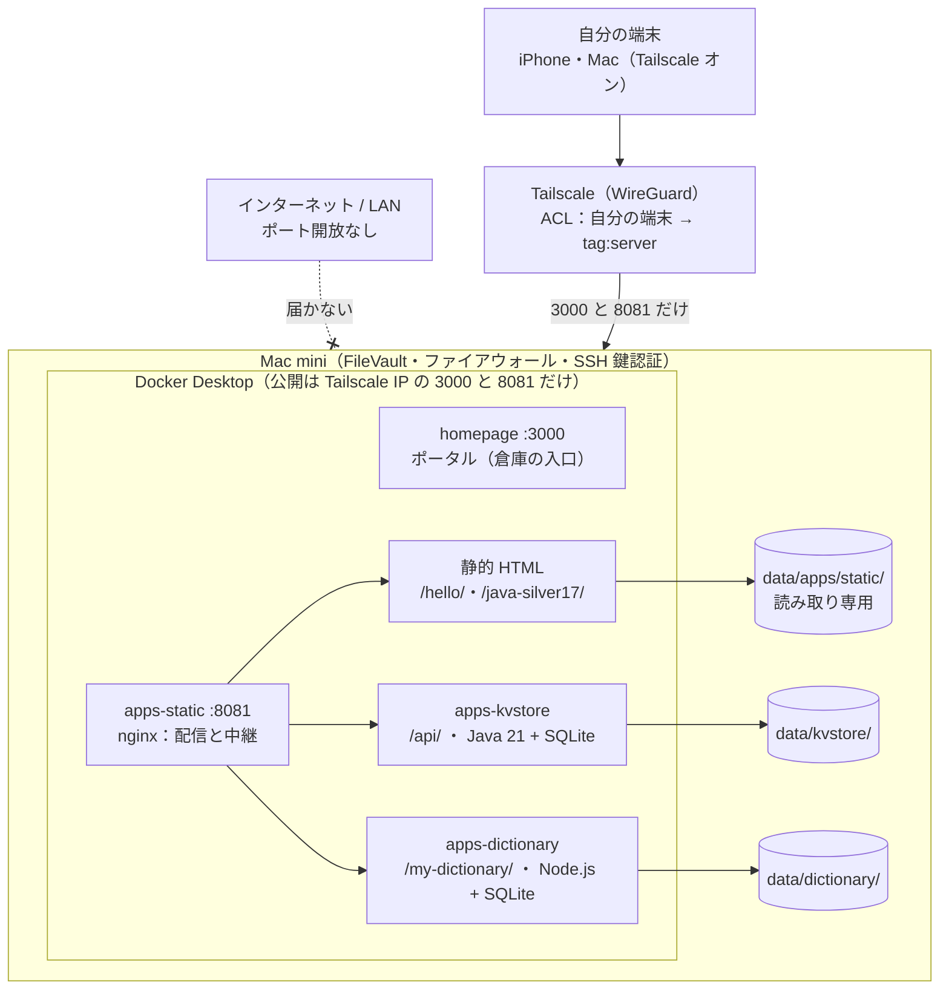

# システム概要

何のためのサーバーで、どうつながっているかをまとめます。構成図の実際の値は伏せ字です（`設定値.md`）。

倉庫サーバーは、自作アプリを外出先の iPhone からいつでも開けるようにする、自分専用のサーバーです。インターネットにはポートを1つも開けず、Tailscale でつながった自分の端末だけが届きます。

自分の端末は Tailscale を通って Mac mini の 3000（ポータル）と 8081（nginx）にだけ届き、nginx が URL の頭で静的 HTML・KVストア・My辞書に振り分けます。

## 1-1. 目的

| 目的 | 状態 |
| --- | --- |
| Claude で作った自作アプリの「倉庫」。iPhone のホーム画面「倉庫」から外出先でも開ける | 稼働中 |
| 学習アプリの進捗をサーバーに保存し、通勤中の iPhone と家の Mac で続きから使う | 稼働中 |
| 写真・動画（DJI 含む）のバックアップ（Immich） | 保留（外付けドライブ未購入） |
| ファイル共有（SMB）、研修で作ったバス予約アプリの常時稼働 | 未着手 |
| AWS・Linux の学習を実機で裏付ける場として使う | 継続中 |

## 1-2. ハードウェア

| 項目 | 仕様 |
| --- | --- |
| 本体 | Mac mini（M4 Pro） |
| CPU / GPU | 12コア（高性能8・高効率4）/ 16コア GPU |
| メモリ | ユニファイドメモリ 24GB（帯域幅 273GB/s） |
| ストレージ | 内蔵 SSD 512GB（`df` 上は 460GiB、構築開始時の使用量約12GB） |
| 背面ポート | Thunderbolt 5 ×3、HDMI ×1、ギガビット Ethernet ×1 |
| 前面ポート | USB-C ×2、3.5mm ヘッドホンジャック |
| 無線 | Wi-Fi 6E、Bluetooth 5.3 |
| 電源ボタン | 本体底面、背面寄りの角 |
| OS | macOS 26.6.2（構築時の値） |
| ホスト名（ターミナル表示） | `Your-Mac` |

## 1-3. 構成の考え方（建物のたとえ）

| 部品 | たとえ | 役割 |
| --- | --- | --- |
| Tailscale | 玄関の鍵 | 自分の端末同士だけを WireGuard で暗号化してつなぐ VPN。外からの入口はここだけ |
| macOS | 建物の土台 | FileVault（ディスク暗号化）、ファイアウォール、SSH 鍵認証 |
| Docker Desktop | 部屋を作る仕組み | アプリごとに隔離した「コンテナ」で動かす |
| コンテナ | 各部屋 | Homepage、nginx、KVストア、My辞書 |
| ターミナル | 操作盤 | すべての操作をコマンドで行う |

## 1-4. 設計原則

この7つは、これまでの全作業で守ってきたものです。Claude Code でもそのまま守ります（14章の CLAUDE.md 案にも入れてあります）。

1. **ポート開放ゼロ**。ルーターのポートフォワードはしない。外からは Tailscale 経由のみ。Tailscale Funnel（インターネット公開機能）も使わない
2. **Docker のポートは Tailscale IP にバインド**する。`"8081:8080"` のような全公開は禁止（LAN の他の機器からも見えてしまう）
3. **外に出すポートは最小**。新しいアプリは原則として nginx（8081）の配下に入れ、独自のポートを持たせない
4. **イメージはバージョン固定**。`latest` を使わない
5. **非 root で動かす**。可能な限り `user: "501:20"` や非 root 版イメージを使う
6. **データはローカルに置き、クラウド依存を減らす**。外部 API の利用料も抑える
7. **障害を「防ぐ」より「必ず起きる前提で備える」**。オフラインバックアップですぐ戻せる形を目指す

構築の順番は「Tailscale → OS の要塞化 → サービスを1つずつ」です。一度に複数入れないことで、問題の切り分けが楽になります。
